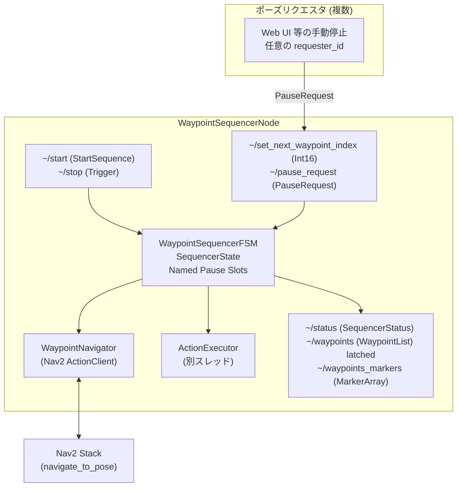
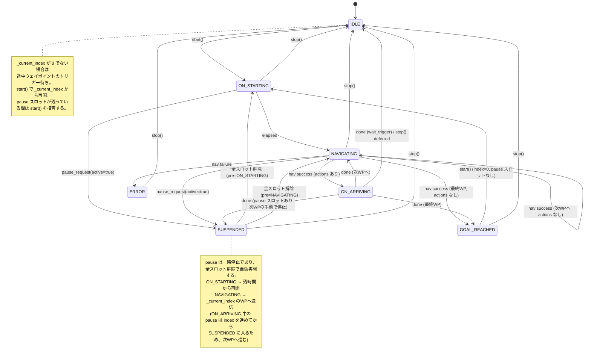

# mg_waypoint_navigation アーキテクチャ

## 概要

`mg_waypoint_navigation` は MG-01 の自律走行における経路追従を担うパッケージ。
従来の `waypoints_follower.py` (mg_navigation) を FSM ベースで完全再設計した。

---

## パッケージ構成

```
mg_waypoint_navigation/
  mg_waypoint_navigation/          # Python ライブラリ
    waypoint.py                    # データモデル v2.0
    waypoint_v1_compat.py          # v1→v2 変換ロジック
    waypoint_sequencer/
      states.py                    # SequencerState enum
      fsm.py                       # WaypointSequencerFSM
      navigator.py                 # WaypointNavigator (Nav2 ラッパー)
      action_executor.py           # ActionExecutor (別スレッド実行)
      costmap_mode.py              # navigation_mode に応じた global_costmap のセンサ障害物層の切り替え
      map_loader.py                # 測位用・計画用の地図の読み込みと、読み込み済みの地図の記録 (~/loaded_maps)
      actions/
        base.py                    # BaseAction
        generic.py                 # GenericServiceAction / GenericPublishAction
        builtins.py                # LoadMapAction / AmclResetAction / WaitAction / WaitTriggerAction / SetNavigationModeAction
  scripts/
    waypoint_sequencer_node.py     # メインノード
    waypoint_editor_node.py        # ウェイポイント編集ノード
    migrate_waypoints.py           # v1→v2 変換ツール
  launch/
    waypoint_sequencer.launch.py
    waypoint_editor.launch.py
  waypoint_tool/                   # waypoint-tool 用のスキーマ・エクスポートテンプレート
    mg_waypoint.schema.json
    mg_waypoint_v2.wpt_template
    mg_gnss_transform.wpt_template
  test/                            # pytest
  behavior_trees/
    mg_navigate_to_pose.xml             # 通常時。FollowPath失敗時にSpin/ClearCostmap/Wait/BackUpのリカバリーを1段階ずつ行い、空けばIsPathClearで中断する
    mg_navigate_to_pose_queue_wait.xml  # queue_waitモード。回避動作なしでWaitのみ（列に詰める動作用）
  rviz/
    waypoint_editor.rviz
  doc/
    architecture.md
    waypoint_format.md
```

---

## コンポーネント図



`PauseRequest`は Web UI の手動停止など明示的な一時停止要求のための汎用機構であり、衝突対応はこの経路を使わない（下記「衝突対応」参照）。

---

## 衝突対応

衝突検知から回避までの一連の振る舞いは、`WaypointSequencerFSM`やPauseRequestを経由せず、**Nav2標準機構の組み合わせで`navigate_to_pose`アクション内部に完結する**（旧`mg_navigation/scripts/collision_behavior_node.py`は廃止済み）。

- **急な動的障害物への即時停止**: `mg_navigation`の`collision_monitor`（`nav2_collision_monitor`）が`cmd_vel_nav`→`cmd_vel_collision`に介入し、`PolygonStop`（速度即ゼロ）、`PolygonSlowdown`（減速）、`PolygonApproach`（時間投影による連続減速）で低遅延に止まる・減速する。障害物を主に避けるのは、RPP（`FollowPath`）自身のコストマップベース衝突チェック（`use_collision_detection`）で、`collision_monitor`はその後ろ盾（[衝突の防止](../../mg_navigation/doc/costmap_and_collision.md#衝突の防止-collision_monitor)）。
- **一定時間待つ**: RPPが前方の障害物で止まると、`controller_server`の`failure_tolerance`の間は速度0で待ち、超えると`FollowPath`アクションを失敗させる。`progress_checker`（`movement_time_allowance`）は詰まりの検知で、待っている途中に障害物が去ったときに再開が間に合うよう、`failure_tolerance`より長くしてある（[mg_navigation](../../mg_navigation/doc/architecture.md)）。これらは`controller_server`単一インスタンスの共有設定のため、衝突対応専用ではなく下記`queue_wait`モードのFollowPathにも同じ値が効く点に注意。
- **計画の失敗では止めない**: 定期的な経路の計画が失敗しても、`CommitPath`（`mg_navigation`のBTプラグイン）が直前の経路を保つので、止まるかどうかはRPPの衝突判定で決まる。新しいゴールへの経路がないときだけ、経路を捨ててリカバリーに入る。
- **解消しなければ回避行動**: 上記の失敗をトリガーに、`mg_navigate_to_pose.xml`の`RecoveryNode`のリカバリーが発火する。1回のリカバリーの中で段階（自己位置が信頼できるときだけ、計画用地図の進入禁止の領域にめり込んでいれば領域の外から計画して脱出 → 引き直し → コストマップのクリアと引き直し → 実在の障害物で塞がっているときだけゆっくり短い後退と引き直し → ゆっくり首振りと引き直し → 待機）を`Fallback`で順に試し、引き直した経路が`IsPathBlocked`で塞がっていなければ、その時点で走行に戻る。試行回数は実質無制限で、詰まりは診断`waypoint_sequencer_node: progress`で知らせる。首振り・後退は`behavior_server`が担当し、`collision_monitor`を経由せず`cmd_vel`に直接publishするため、その間の安全性は`behavior_server`自身のローカルコストマップベースの衝突チェックに委ねられる。段階の順序の理由と既知の制約は[README](../README.md#障害物に出会ったときの動き-両-bt-共通の考え方)。
- **まず待つ**: 定期的な再計画の先頭で`IsPathBlocked`（`mg_navigation`のBTプラグイン）が経路の近くの塞がりを調べ、塞がっている間は再計画しない。急に現れた障害物の前では、迂回せずに`failure_tolerance`の間待つ。待ち時間を計画の周期で決めないので、ばらつかない。
- **空いたらすぐ走行へ戻る**: リカバリーの間は`IsPathClear`（`mg_navigation`のBTプラグイン）が、RPPが衝突判定なしで走り出せるかをRPPと同等以上の基準で調べ、塞がっていた経路が空いたら回避行動を中断して走行に戻る。詳細は[README](../README.md#障害物に出会ったときの動き-両-bt-共通の考え方)。
- **列に並ぶ区間（queue_wait）**: `set_navigation_mode`アクションで`navigation_mode`を`queue_wait`に切り替えると、`mg_navigate_to_pose_queue_wait.xml`が使われる。こちらはリトライ無制限・待機のみで回避動作を行わず、列に詰める動作を再現する（前が空けば`IsPathClear`で待機を中断する）。
  同時に、global_costmapのセンサ障害物層（`top_obstacle_layer`・`obstacle_stvl_layer`）を無効にするので、グローバル経路は動的障害物を避けずに引かれる（`static_layer`と`inflation_layer`は有効のまま。local_costmapは変えない）。障害物の手前での停止は`collision_monitor`とRPPの衝突チェックが担う。`normal`に切り替えると層を有効に戻す。自動では戻さないので、列の区間の終わりに`normal`を呼ぶ。

パラメータの詳細は`mg_navigation/params/nav2_params.yaml`のコメントを参照。

---

## FSM 状態遷移図



---

## ROS インターフェース

### WaypointSequencerNode

| 種別    | トピック/サービス名         | 型                               | 説明                                         |
| ------- | --------------------------- | -------------------------------- | -------------------------------------------- |
| Service | `~/start`                   | `mg_msgs/StartSequence`          | IDLE/GOAL_REACHED → ON_STARTING (pause 中は拒否) |
| Service | `~/stop`                    | `std_srvs/Trigger`               | 任意状態 → IDLE (pause スロットも全解除)     |
| Service | `~/reload_waypoints`        | `std_srvs/Trigger`               | IDLE/GOAL_REACHED/ERROR 時のみ有効           |
| Service | `~/navigate_to_pose`        | `mg_msgs/SendGoal`               | BT を指定してゴールを 1 つ送る手動ゴール。`navigation_mode` は `normal` / `queue_wait` (`set_navigation_mode` と同じ BT と、global_costmap のセンサ障害物層の切り替え) か `default` (BT も層も変えず、Nav2 の既定の BT)。IDLE/GOAL_REACHED/ERROR で pause 中でないときだけ受け付ける。実行中は `~/start` を拒否し、`~/stop` でキャンセルする。層の切り替えに失敗したときはゴールを送らない。ゴールの終了時に層は戻さない (戻すのは `normal` で送るか Nav2 の再起動)。`~/navigation_mode` (シーケンスのモード) は変えない |
| Service | `~/load_map`                | `mg_msgs/LoadMaps`               | 測位用・計画用の地図を map_server に読み込ませる (空文字の側は変更しない)。状態によらず実行でき、`load_map` アクションと同じ経路 |
| Sub     | `~/set_next_waypoint_index` | `std_msgs/Int16`                 | IDLE/SUSPENDED 時のみ有効                    |
| Sub     | `~/pause_request`           | `mg_msgs/PauseRequest`           | Named Pause Slot 制御 (複数ノードから送信可) |
| Pub     | `~/status`                  | `mg_msgs/SequencerStatus`        | パラメータで無効化可                   |
| Pub     | `~/activity`                | `mg_msgs/NavigationActivity`     | 走行の「いまの活動」の要約 (transient_local)。`publish_activity` で無効化可。[いまの活動](#いまの活動-activity) |
| Pub     | `~/waypoints`               | `mg_msgs/WaypointList`           | transient_local latched                      |
| Pub     | `~/waypoints_markers`       | `visualization_msgs/MarkerArray` | RViz 表示                                    |
| Pub     | `~/loaded_maps`             | `mg_msgs/LoadedMaps`             | map_server に読み込ませた地図 (読み込みに成功したものだけを記録)。transient_local latched |
| Pub     | `~/navigation_mode`         | `std_msgs/String`                | 次のゴールで使うモードと BT の JSON (`{"mode": "normal", "behavior_tree": "<ファイル名>"}`)。変化したときだけ。transient_local latched |
| Pub     | `/diagnostics`              | `diagnostic_msgs/DiagnosticArray` | (`diagnostic_updater`)。`waypoint_sequencer_node: progress`: 走行中でなければ OK (`not navigating`)、走行中に位置が `stall_distance` 以上動かない時間が `stall_warn_sec` 以上なら WARN (`no progress for N s`)。values に `stalled_sec` と `number_of_recoveries` (NavigateToPose のフィードバック) |

### ノードパラメータ

| パラメータ | 型 | 説明 |
| :--- | :--- | :--- |
| `load_path` | string | ウェイポイント YAML パス |
| `publish_waypoint_status` | bool | ステータスパブリッシュ有効/無効 |
| `waypoint_status_freq_hz` | double | ステータスパブリッシュ周波数 |
| `publish_waypoints_list` | bool | ウェイポイントリストパブリッシュ |
| `bt_xml_normal` | string | 通常モードの BT |
| `bt_xml_queue_wait` | string | queue_wait モードの BT |
| `plan_topic` | string | 通過点判定に使う経路のトピック。BT の `CommitPath` が採用した経路 (`/navigation/committed_path`) を使う。planner_server の `/plan` は棄却された候補も含むので使わない |
| `initial_localization_map` | string | 起動時に map_server が読み込んでいる測位用地図 (`~/loaded_maps` の初期値。`mg_navigation` の bringup が渡す) |
| `initial_planning_map` | string | 起動時に planning_map_server が読み込んでいる計画用地図 (同上) |
| `plan_goal_match_tolerance` | double | 経路の終点をゴールのものとみなす距離 [m]（NavFn の `tolerance` 以上にする） |
| `stall_distance` | double | 詰まりの検知で、進んだとみなす移動距離 [m] |
| `stall_warn_sec` | double | 位置が進まない時間がこれ以上になったら `/diagnostics` に WARN を出す [s]。`~/activity` の `no_progress` の判定にも使う (判定は 1 つ) |
| `publish_activity` | bool | `~/activity` の配信。`false` なら購読もしない |
| `activity_freq_hz` | double | `~/activity` の配信周波数 |
| `activity_collision_state_topic` | string | 障害物での停止・減速の入力。空にするとこの入力は使わない |
| `activity_bt_log_topic` | string | リカバリーの入力。空にするとこの入力は使わない |
| `activity_nav_status_topic` | string | シーケンサを通らないゴール (RViz の 2D Goal Pose など) の検出に使う入力。空にすると、その検出だけ止まる |
| `activity_path_check_topic` | string | 遠回りの棄却の入力 (`mg_msgs/PathCandidateCheck`)。空にするとこの入力は使わない |

> 読み込み済みの地図の記録は、`load_map` アクションと `~/load_map` を通した読み込みだけが更新する。
> `/map_server/load_map` などを直接呼んだ場合は記録とずれる。

### いまの活動 (activity)

`~/activity` (`mg_msgs/NavigationActivity`) は、走行が「いま何をしているか」の要約。シーケンサ経由の走行に加えて、シーケンサを通らないゴール (RViz の 2D Goal Pose など) の走行も `external_goal` として出す。表示用で、制御の入力にはしない。判定はここ (`waypoint_sequencer/activity.py` の `compose_activity`、ROS に依存しない純関数) だけで行い、UI は表示するだけにする ([doc/monitoring.md](../../doc/monitoring.md))。

- **入力**: `SequencerStatus` と同じシーケンサの状態 (`current_action`、`waiting_trigger`、手動ゴールの有無を含む)、`activity_collision_state_topic` (`nav2_msgs/CollisionMonitorState`)、`activity_bt_log_topic` (`nav2_msgs/BehaviorTreeLog`)、`activity_nav_status_topic` (`action_msgs/GoalStatusArray`、Nav2 のアクションの状態)、`activity_path_check_topic` (`mg_msgs/PathCandidateCheck`、`CommitPath` の遠回りの判定)、位置が進まない時間 (`ProgressMonitor`)。
- **遠回りの棄却**: 判定は `CommitPath` が行い、シーケンサは最新の判定を保持する (採用の判定が届く、または走行中でなくなると消える)。最新の判定が棄却で、かつリカバリー中のときだけ、リカバリーの表示に代えて `detour_rejected` を出す。棄却しても今の経路で走れているときは出さず、停止・進めないの表示も隠さない。棄却している間、定期の再計画は経路の近くが塞がっていると止まるので、判定が届くのはリカバリーの引き直しのときが中心。
- **外部のゴールの判定**: Nav2 のアクションに生きたゴール (ACCEPTED / EXECUTING) があり、シーケンサ自身が送ったゴールが結果の返るまでの間に無く (`WaypointNavigator.has_live_goal`)、その状態が `EXTERNAL_GOAL_HOLD_SEC` 続いたとき。この時間は、シーケンサのゴールの結果とアクションの状態の到着順の差を吸収するためのもの。アクションの状態は変化したときしか届かないので、発行側が居なくなったら最後の値を捨てる。
- **配信**: `activity_freq_hz` のタイマーからだけ合成する (専用の callback group)。状態が変わってから、最大でタイマーの周期だけ遅れる。`elapsed_sec` は同じ `code` が続いている秒数。
- **`text` は固定の短い説明**で、変わる数値は `index` / `total` / `remaining` で渡す。`emphasis` は表示の強調で、健全性ではない (健全性は `/diagnostics_agg`)。

優先順位 (上から。最初に当たったもの):

| 条件 | `code` |
| :--- | :--- |
| `SUSPENDED` | `paused` (`detail` は要求元) |
| `ON_STARTING` | `departure_wait` (`remaining` は残り秒数) |
| `ON_ARRIVING` | `action` (`detail` はアクションの type) |
| `NAVIGATING`、手動ゴール中、外部のゴール (下の `ERROR` の次): リカバリー中で、直近の経路の候補を遠回りが長すぎるとして棄却中 | `detour_rejected` (`detail` は経路の長さと上限) |
| 同上: リカバリー中 | `recovery` |
| 同上: collision_monitor が停止、`source_timeout:` | `sensor_timeout_stop` |
| 同上: collision_monitor が停止 | `obstacle_stop` (`detail` はポリゴン名) |
| 同上: 位置が `stall_warn_sec` 以上進まない | `no_progress` |
| 同上: collision_monitor が減速 (`slowdown` と `approach`) | `obstacle_slowdown` |
| 同上: 上のどれでもない | `navigating` (手動ゴールなら `manual_goal`) |
| `ERROR` | `error` |
| 外部のゴールを走行中 (上の停止・減速・リカバリーに当たらなかったとき) | `external_goal` |
| `IDLE` でトリガー待ち | `trigger_wait` |
| `GOAL_REACHED` | `goal_reached` |
| 上のどれでもない | `idle` |

リカバリーは、BT のログで実行中の BT ノード名から決める。名前と文言の表は `activity.py` の `RECOVERY_TEXTS` で、自作の BT の名前 (`SpinLeftAndReplan` など) を先に、Nav2 既定の BT 用の汎用の名前 (`Spin`、`BackUp`、`Wait`) を後に置く。BT の XML を変えたら、この表も合わせる (`test_bt_recovery_names.py` が照合する)。`FollowPath` が動き出したとき、走行中でなくなったときは、リカバリーの記録を消す。

**制約**

- シーケンサの再起動直後は、collision_monitor の状態が次に変わるまで「障害物なし」として扱う (変化したときしか配信されない)。
- シーケンサを通らないゴールは `navigate_to_pose` のものだけ (`navigate_through_poses` は対象外)。ゴールを送ってから表示に出るまで少し遅れる。外部のゴールでは、残り距離と `no_progress` は出さない (`ProgressMonitor` はシーケンサのゴール専用)。
- シーケンス走行中に RViz からゴールを送ると、Nav2 がシーケンサのゴールを置き換えるため、シーケンスが失敗しうる (この機能の前からの挙動で、表示は変えていない)。外部のゴールの判定は、シーケンサ自身のゴールが結果を返すまで有効にならない。
- 非常停止 (E-Stop) は入力にしない (Web UI の上部バーが常に表示する)。
- collision_monitor の範囲の外で障害物の手前で待っている間 (コントローラーの待ち) は、`stall_warn_sec` に達するまで `navigating` と表示される。
- `SequencerStatus` にフィールドを足したので、古い rosbag を `ros2 bag play` で再生すると、新しい型の購読側が読めない。
- 合成を別のノードへ移すときは、`SequencerStatus` に `stalled_sec` と `manual_goal_active` を足す (今は出していない)。

### 到達判定

- **停止点** (`is_through_point: false`): Nav2 の goal_checker で判定する。到達半径は `nav2_params.yaml` の `general_goal_checker.xy_goal_tolerance` で全 WP 共通。`reach_tolerance` は使わない（`xy_goal_tolerance` を実行時に変更すると controller が停止する問題があるため）。
- **通過点** (`is_through_point: true`): 次の 3 条件をすべて満たした時点で通過 (`PASSED`) とする。
  1. ゴール送信後に受信した採用済みの経路（`plan_topic`。BT の `CommitPath` が publish）で、終点がゴールから `plan_goal_match_tolerance` 以内のものを採用済み。前のゴールへの経路は使わない。BT に `CommitPath` がないと配信されず、通過点の判定ができない（停止点と同じく Nav2 の到達で終わる）。採用済みの経路が届かないまま一定時間たつと、イベント `nav.through_plan_missing` を WARN で 1 回出す。
  2. 採用した経路に沿った残り距離が `through_tolerance` 以下。最近傍点は前回位置から経路に沿って 2m 先までだけ探す（経路が自分の近くを再び通る形でも、先の区間を誤って選ばない）。
  3. ゴールまでの直線距離が `through_tolerance` 以下。

  Nav2 フィードバックの `distance_remaining` は判定に使わない。BT blackboard の経路はゴールをまたいで残るので、新しいゴールの経路を計画し終えるまで、前の経路で計算した値が返るため。
  goal_checker の `xy_goal_tolerance` 以内に入って Nav2 が成功を返した場合も到達になる。

### 通過後のゴールの扱い（preemption）

- 通過した後も Nav2 のゴールは止めない。FSM がすぐ次の WP へ向かう場合は、同じ BT の次のゴールでそのまま**上書き**する（bt_navigator の preemption）。ロボットは減速・停止せずに走り続ける。上書きされた古いゴールは ABORTED で終わるが、無視する。
- 次のいずれかの場合は `cancel` して止まる: アクション実行（ON_ARRIVING）、最終 WP（GOAL_REACHED）、wait_trigger（IDLE）、pause（SUSPENDED）。
- BT が異なるゴール（navigation_mode の切り替え）は Nav2 が上書きを受け付けない。キャンセル中のゴールも同様。これらの場合は、走っているゴールの終了を待ってから次のゴールを送る。
- 上書き直後にすぐ経路を計画し直すため、両方の BT に `GoalUpdatedController` を入れている（RateController の周期を待つと、一定時間のあいだ古い経路を追従してしまうため）。`mg_navigation/params/nav2_params.yaml` の `plugin_lib_names` に `nav2_goal_updated_controller_bt_node` が必要。

### スレッドモデル

- ノードは `MultiThreadedExecutor` で spin する。Nav2 アクションクライアントとアクション用のサービスクライアントは `ReentrantCallbackGroup` に属する。
- on_reached_actions は `ActionExecutor` の別スレッドで実行する。サービス応答は spin せず `threading.Event` で待つ（ノードは既に executor で spin されているため）。
- `WaypointNavigator` は、FSM から見た論理ゴールと、Nav2 上で実際に走っているゴールを区別して管理する。論理ゴールには世代 ID を振り、キャンセル後や次ゴール送信後に届いた古い応答・結果を無視する。受理前にキャンセルされたゴールは、受理された直後にキャンセルする。

---

## Named Pause Slot 機構

複数のノードが独立して一時停止を要求できる仕組み。

- `pause_slots: Set[str]` — `requester_id` の集合
- スロットが1つでも存在すると SUSPENDED 状態を維持
- 全スロットが解放された時、`_pre_suspend_state` に応じて中断箇所から自動再開
- IDLE / GOAL_REACHED / ERROR 中の pause は状態を変えず、スロットだけ登録する（`start()` は拒否される）
- `stop()` は全スロットを解除する

---

## ON_ARRIVING 中の deferred 処理

アクション実行中に stop/pause が届いた場合:

- stop: `_stop_pending = True` → アクション完了後に IDLE へ
- pause: アクション完了時点で pause スロットが残っていれば、index を次へ進めてから SUSPENDED へ（途中で解除されていれば、そのまま次WPへ進む）。最終WPなら GOAL_REACHED、wait_trigger 付きなら IDLE を優先する
- stop が優先 (両方届いた場合は stop)
- 実行中のアクション自体は中断できない（`wait` やサービス待ちが終わるまで待つ）
